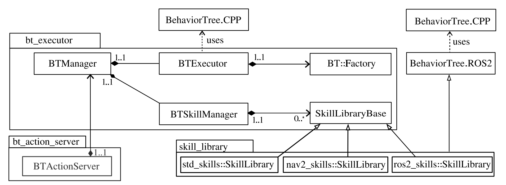

# Fraunhofer Italia Behavior Tree Stack

Author: [Michael Terzer](mailto:michael.terzer@fraunhofer.it) - Fraunhofer Italia

This stack of ROS2 packages provides a framework to manage and execute behavior trees. It provides a plugin-based architecture to load custom behavior tree nodes, or so called skills. It is based on the [BehaviorTree.CPP](https://www.behaviortree.dev/) library and uses the interfaces of the [BehaviorTree.ROS2](https://github.com/BehaviorTree/BehaviorTree.ROS2) repository.


The stack provides following important features:

* **Remote missions:** send a tree’s full XML and its blackboard as an action goal. A Python client and CLI are included.
* **Runtime control:** run, pause, resume, stop, and step a tree one tick at a time for debugging.
* **Automatic tree loading:** trees are found recursively by name, and shared subtrees can be loaded from separate folders.
* **Plugin skills:** skill libraries are pluginlib plugins built on BehaviorTree.ROS2 wrappers, with a template package (bt_demo_skills) to start from.


The **bt_executor** package hosts several classes to execute a behavior tree and to manage the so called skill libraries, being behavior-tree-node-plugins that can be hosted in separate packages somewhere in your workspace. A demo of such skills can be found in **bt_demo_skills**.

The **bt_action_server** package implements a ROS2 action server that uses a bt_executor instance to run a tree. The tree can be loaded from a path or sent as a string, accompanied with a blackboard to the executor.

The **bt_service_server** package implements mutiple ROS2 service servers that wrap some base-class functions from the bt_executor package as ROS2 services.

The **behavior_tree_msgs** package collects message types that are used within this stack.

The **bt_demo_skills** package demonstrates the implementation of skills that are loaded by the **bt_skill_manager** from the **bt_executor** package.

For more detailed information, please see the specific package documentations.

Following graphics shows the class and package diagram.

 


## Cloning

This repository comes with a [vcs-tool](https://github.com/dirk-thomas/vcstool) setup. Import the needed repositories by:

```
vcs import < .repos
```

## Docker

The stack comes with a docker-compose setup.

### Build the docker

To build the docker, navigate to the docker directory and run:

```
cd docker
docker compose build
```

### Run a simple demo in the docker container

Run the docker:

```
docker compose up 
```

Open a bash of the container:

```
docker exec -it bt_stack /bin/bash
```

Within the container, build the workspace:

```
colcon build
```

Run the demo application in the container:

```
source install/setup.bash && ros2 launch bt_demo_skills behavior_tree.launch.py
```

Run tests (inside container):

```javascript
./src/run_tests.bash
```

# Licence & Acknowledgement

The behavior_tree_stack is licensed under the terms of the Apache License 2.0.
Parts of the code are inspired from the [BehaviorTree.CPP](https://github.com/BehaviorTree/BehaviorTree.CPP) and [BehaviorTree.ROS2](https://github.com/BehaviorTree/BehaviorTree.ROS2) libraries. BehaviorTree.ROS2 in turn was inspired from [Nav2](https://docs.nav2.org/). For this reason, we keep the same license and copyright. For more information, consult the LICENCE file.

The project has recieved financial support by the Horizon 2020 EU Project [CONCERT](https://concertproject.eu/).

# Citation

Please find parts of this work in the below article. Any citation would be very appreciated!

```
@article{Terzer2024,
  title = {Facilitated Construction Robot Programming based on Building Information Modelling},
  author = {Terzer, Michael and Flatscher, Tobit and Magri, Marco and Garbin, Simone and Emig, Julius and Giusti, Andrea},
  journal = {10th International Conference on Control, Decision and Information Technologies},
  year = {2024},
  publisher={IEEE}
}
```


